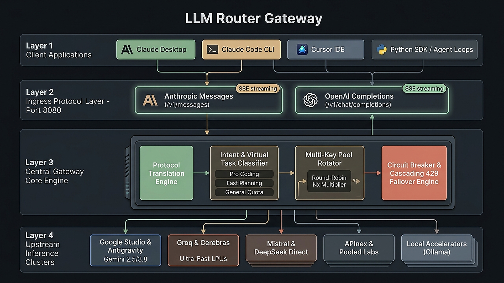

# LLM Router


> High-throughput, fault-tolerant local LLM routing gateway aggregating 39+ AI providers and local accelerators into unified Anthropic Messages (`/v1/messages`) and OpenAI Chat Completions (`/v1/chat/completions`) endpoints.

---

## Architectural Overview

LLM Router acts as an autonomous proxy layer between client interfaces (Claude Desktop, Claude Code CLI, Cursor, Continue.dev, or custom agent frameworks) and upstream AI inference providers. It abstracts provider-specific rate limits, authentication mechanisms, and schema differences behind a single resilient interface.

<p align="center">
  
</p>

```
                    ┌────────────────────────────────────────────────────────┐
                    │                    Client Ecosystem                    │
                    │   Claude Desktop  •  Claude Code  •  Cursor  •  SDKs   │
                    └───────────────────────────┬────────────────────────────┘
                                                │
                                  ┌─────────────┴─────────────┐
                                  │ HTTP / SSE (Port 8080)   │
                                  │  • /v1/messages           │
                                  │  • /v1/chat/completions   │
                                  └─────────────┬─────────────┘
                                                │
                    ┌───────────────────────────▼────────────────────────────┐
                    │               LLM Router Gateway Core                  │
                    │                                                        │
                    │   ┌────────────────────┐   ┌───────────────────────┐   │
                    │   │ Protocol Adapter   │   │ Intent & Tier Router  │   │
                    │   │ (Anthropic/OpenAI) │   │ (Pro/Fast/General)    │   │
                    │   └─────────┬──────────┘   └──────────┬────────────┘   │
                    │             │                         │                │
                    │   ┌─────────▼──────────┐   ┌──────────▼────────────┐   │
                    │   │ Key Pool Rotator   │   │ Circuit Breaker &     │   │
                    │   │ (Round-Robin/Rate) │   │ Fallback Engine (429) │   │
                    │   └────────────────────┘   └───────────────────────┘   │
                    └───────────────────────────┬────────────────────────────┘
                                                │
         ┌───────────────────┬──────────────────┼───────────────────┬───────────────────┐
         ▼                   ▼                  ▼                   ▼                   ▼
┌─────────────────┐ ┌─────────────────┐ ┌───────────────┐ ┌──────────────────┐ ┌─────────────────┐
│ Google Studio & │ │ Groq & Cerebras │ │ Mistral &     │ │ APInex, Airforce │ │ Local Run-time  │
│ Antigravity Hub │ │ High-Speed LPU  │ │ DeepSeek Direct│ │ & Pooled Labs    │ │ (Ollama/Custom) │
└─────────────────┘ └─────────────────┘ └───────────────┘ └──────────────────┘ └─────────────────┘
```

---

## Core Capabilities

### 1. Dual Protocol Engine

- **Anthropic Messages Protocol (`/v1/messages`)**: Native drop-in compatibility for Claude Desktop (Developer Mode Gateway) and Claude Code CLI, supporting full Server-Sent Events (SSE) streaming and bidirectional structured tool calling.
- **OpenAI Chat Protocol (`/v1/chat/completions`)**: Standardized compatibility for IDE extensions (Cursor, Continue.dev), LangChain, LlamaIndex, and native OpenAI client libraries.

### 2. Cascading Failover & Resiliency

- **Instant Circuit Breaking**: If an upstream provider returns HTTP 429 (Rate Limited), 5xx (Service Unavailable), or connection timeouts, the engine cascades to the next operational provider in milliseconds without dropping the active client stream.
- **Adaptive Cooldowns**: Depleted keys and rate-limited endpoints are quarantined in dynamic cooldown queues (configurable via `config/config.yaml`) and automatically re-admitted when their quota resets.

### 3. Multi-Key Pooling

- **Linear Throughput Multiplication**: Supply comma-separated API keys per provider in your `.env` configuration (e.g., `GEMINI_API_KEYS="key_1,key_2,key_3"`). The router distributes requests round-robin across the pool, effectively multiplying standard free-tier rate limits by $N\times$.

### 4. Zero-Restart Local Antigravity Authentication

- Integrates with local Google Chromium and Antigravity development sessions, auto-detecting OAuth credentials from memory/storage.
- Unlocks higher throughput brackets (up to 60 RPM / 10,000 RPD) across Gemini 3.8 Flash and Gemini 2.5 Pro without requiring server reboots.

### 5. Architectural Control Panel

- Real-time telemetry dashboard served locally at `http://localhost:8080/`.
- Industrial dark workstation aesthetic utilizing a strict 6-color palette (*Sage Green, Warm Sand, Muted Coral, Slate Gray, Beige, Off White*).
- Asymmetric masonry multi-column provider cards with accordion expand/collapse controls.
- Structural separation of provider models into **Available** and **Inavailable** categories with real-time toggle persistence.
- Dual-pane test console featuring live SSE streaming metrics and routing diagnostics.

---

## Virtual Task-Centric Stacks & Model Aliases

Rather than binding clients to a single fragile model, LLM Router exposes logical stacks that dynamically route requests to the best available engine within that class:

| Target Model / Alias                     | Primary Intent                                                       | Default Routing Hierarchy                                                                                                                                   |
| :--------------------------------------- | :------------------------------------------------------------------- | :---------------------------------------------------------------------------------------------------------------------------------------------------------- |
| **`pro-coding-reasoning`**       | Complex architecture, code synthesis, mathematical reasoning.        | APInex Qwen 3.8 Max &rarr; DeepSeek V4 Pro &rarr; Antigravity Gemini 2.5 Pro &rarr; Mistral Codestral &rarr; DeepSeek Reasoner &rarr; Cerebras GPT-OSS 120B |
| **`fast-planning-light`**        | Task decomposition, lightweight logic, fast sub-agent execution.     | Cerebras Qwen 3.8 27B &rarr; Groq GPT-OSS 20B &rarr; APInex GLM 5.3 Flash &rarr; Gemini 3.5 Flash Lite &rarr; Groq Llama 4 Scout                            |
| **`general-massive-quota`**      | General-purpose transformations, massive text volume, summarization. | APInex Gemini 3.8 Flash &rarr; GPT-6 Luna &rarr; Gemini Direct &rarr; Groq Direct &rarr; Cloudflare Workers AI &rarr; ModelScope                            |
| **`claude-3-7-sonnet-latest`**   | Claude Desktop alias for Pro Coding stack.                           | Mirrors `pro-coding-reasoning` with native Anthropic parameter mapping.                                                                                   |
| **`claude-3-5-haiku-20241022`**  | Claude Desktop alias for Fast Planning stack.                        | Mirrors `fast-planning-light` with native Anthropic parameter mapping.                                                                                    |
| **`claude-3-5-sonnet-20241022`** | Claude Desktop alias for General High-Quota stack.                   | Mirrors `general-massive-quota` with native Anthropic parameter mapping.                                                                                  |

---

## Supported Upstream Ecosystem

LLM Router orchestrates 39+ AI labs and inference providers, aggregating over 1.25 billion monthly pooled tokens:

| Provider                        | Supported Free Tier Bracket      | Flagship Models Exposed                         | Management Portal                                               |
| :------------------------------ | :------------------------------- | :---------------------------------------------- | :-------------------------------------------------------------- |
| **Google AI Studio**      | 15 RPM / 1,500 RPD / 1M TPM      | Gemini 3.8 Flash, 2.5 Pro, 3.5 Flash Lite       | [aistudio.google.com](https://aistudio.google.com/apikey)        |
| **Google Antigravity**    | 60 RPM / 10,000 RPD              | Gemini 3.8 Flash, Gemini 2.5 Pro                | [Local Auto-Detect]                                             |
| **Groq Cloud**            | 30 RPM / 14,400 RPD (~300 tok/s) | Llama 3.3 70B, GPT-OSS 120B, Qwen 3.8           | [console.groq.com](https://console.groq.com/keys)                |
| **Cerebras Cloud**        | 30 RPM / 60k TPM (~2,000 tok/s)  | GPT-OSS 120B, Qwen 3.8 27B, Llama 3.1 8B        | [cloud.cerebras.ai](https://cloud.cerebras.ai/)                  |
| **APInex Direct**         | 5 RPM / 5,000 RPD                | DeepSeek V4 Pro, Qwen 3.8 Max, Gemini 3.8 Flash | [apinex.bond](https://apinex.bond/)                              |
| **Mistral AI**            | 30 RPM / 1,000 RPD               | Codestral Latest, Mistral Large, Mistral Small  | [console.mistral.ai](https://console.mistral.ai/)                |
| **DeepSeek Platform**     | High Efficiency Tier             | DeepSeek-V3, DeepSeek-R1 Reasoner               | [platform.deepseek.com](https://platform.deepseek.com/)          |
| **SambaNova Cloud**       | 30 RPM / 1,000 RPD               | Llama 3.3 70B Instruct, Qwen 2.5 Coder 32B      | [cloud.sambanova.ai](https://cloud.sambanova.ai/)                |
| **Cohere AI**             | 20 RPM / 1,000 Calls/Mo          | Command R+, Command R                           | [dashboard.cohere.com](https://dashboard.cohere.com/)            |
| **Cloudflare Workers AI** | 10,000 Neurons/Day               | Llama 3.3 70B, DeepSeek R1 Distill              | [dash.cloudflare.com](https://dash.cloudflare.com/)              |
| **GitHub Models**         | 15 RPM / 150 RPD                 | GPT-4o, GPT-4o Mini, Llama 3.3 70B              | [github.com/settings/tokens](https://github.com/settings/tokens) |
| **OpenRouter Free**       | 20 RPM / 200 RPD                 | 35+ Curated Free Models                         | [openrouter.ai](https://openrouter.ai/keys)                      |
| **Ollama Local**          | Uncapped Local Hardware          | Any local GGUF / quantized model                | [ollama.ai](https://ollama.ai/)                                  |

---

## Installation & Setup

### 1. Prerequisites

- Python 3.10+ (Python 3.11 or 3.12 recommended)
- Git

### 2. Environment Setup

Clone the repository and install core dependencies in a virtual environment:

```bash
git clone https://github.com/shaurya-gupta-dev/LLM-Router.git
cd LLM-Router

# Initialize virtual environment
python -m venv .venv

# Activate environment (Windows PowerShell)
.venv\Scripts\Activate.ps1
# Activate environment (Linux/macOS)
source .venv/bin/activate

# Install dependencies
pip install -r requirements.txt
```

### 3. Key Configuration

Create a `.env` file based on the provided template:

```bash
cp .env.example .env
```

Open `.env` and add your Master Key and any upstream credentials:

```ini
# Gateway Security Key (used by your client applications)
MASTER_KEY=llm-router-secret-key-12345

# Multi-Key Pooling (Comma-separated entries supported)
GEMINI_API_KEYS=AIzaSyA...,AIzaSyB...
GROQ_API_KEYS=gsk_...,gsk_...
CEREBRAS_API_KEYS=csk-...
MISTRAL_API_KEY=...
DEEPSEEK_API_KEY=...
APINEX_API_KEY=...
```

*Note: You only need **one** valid upstream key to begin routing. Supplying additional keys expands your pooled daily quota and enables automatic failover.*

---

## Operating Modes

### Option A: Interactive Development Mode

To run the server in the foreground with active terminal logging:

```bash
python run.py
```

### Option B: Windows Background Daemon Mode

The repository includes dedicated daemon management scripts for long-running deployments:

```powershell
# Start daemon process silently in background
.\scripts\start.ps1

# Inspect active process PID and gateway metrics
.\scripts\status.ps1

# Terminate running daemon process
.\scripts\stop.ps1
```

*(Alternatively, use `start-background.bat`, `status-router.bat`, and `stop-router.bat` directly from Windows Explorer or CMD).*

### Option C: Docker & Docker Compose (Recommended for Linux/macOS/Cloud)

Run LLM Router containerized with automatic restarts, health probes, and persistent volumes:

```bash
# 1. Prepare configuration
cp .env.example .env

# 2. Build and launch gateway container in background
docker compose up -d

# 3. Stream container telemetry logs
docker compose logs -f

# 4. Stop container
docker compose down
```

---

## Client Integration Guide

### 1. Claude Desktop Application

Connect Claude Desktop directly to your local routing gateway:

1. Launch Claude Desktop.
2. Navigate to **Help** &rarr; **Troubleshooting** &rarr; **Enable Developer Mode**.
3. Under the newly revealed **Developer** menu, select **Configure Third-Party Inference**.
4. Configure the gateway parameters:
   - **Connection Type**: `Gateway`
   - **Gateway Base URL**: `http://localhost:8080/v1`
   - **Gateway Credentials**: `Static API Key` &rarr; `llm-router-secret-key-12345` (matching `MASTER_KEY`)
   - **Available Models**: Add `claude-3-7-sonnet-latest`, `claude-3-5-haiku-20241022`, and `claude-3-5-sonnet-20241022`.
5. Restart Claude Desktop. The app will now route all queries through your resilient local cluster.

---

### 2. Claude Code CLI

Route the official Anthropic Claude Code terminal interface through LLM Router:

**PowerShell:**

```powershell
$env:ANTHROPIC_BASE_URL="http://localhost:8080"
$env:ANTHROPIC_API_KEY="llm-router-secret-key-12345"
claude
```

**Bash / Zsh:**

```bash
export ANTHROPIC_BASE_URL="http://localhost:8080"
export ANTHROPIC_API_KEY="llm-router-secret-key-12345"
claude
```

---

### 3. Cursor & Continue.dev (VS Code)

Configure Cursor or Continue to consume LLM Router as an OpenAI-compatible provider:

- **Model Provider**: `OpenAI Compatible`
- **Base URL**: `http://localhost:8080/v1`
- **API Key**: `llm-router-secret-key-12345`
- **Model Name**: `pro-coding-reasoning` or `claude-3-7-sonnet-latest`

---

### 4. Python SDK (OpenAI Client)

```python
from openai import OpenAI

client = OpenAI(
    base_url="http://localhost:8080/v1",
    api_key="llm-router-secret-key-12345"
)

response = client.chat.completions.create(
    model="pro-coding-reasoning",
    messages=[
        {"role": "system", "content": "You are an expert systems engineer."},
        {"role": "user", "content": "Explain circuit breaker states in distributed gateways."}
    ],
    stream=True
)

for chunk in response:
    content = chunk.choices[0].delta.content
    if content:
        print(content, end="", flush=True)
```

---

## Administration & Telemetry API Reference

The router exposes diagnostic and administrative endpoints alongside standard proxy routes:

| Method   | Endpoint                                    | Description                                                                    |
| :------- | :------------------------------------------ | :----------------------------------------------------------------------------- |
| `GET`  | `/`                                       | Web Control Panel & Inspection Console.                                        |
| `GET`  | `/health`                                 | System health probe (returns `{"status":"healthy","service":"llm-router"}`). |
| `GET`  | `/api/stats`                              | Live telemetry, provider token counters, and RPM/RPD utilization rates.        |
| `GET`  | `/api/admin/models`                       | Discovered models, latency diagnostics, and active toggle maps.                |
| `POST` | `/api/admin/models/toggle`                | Enable or disable a specific provider model dynamically.                       |
| `POST` | `/api/admin/auth/antigravity`             | Configure or inspect local Google Antigravity authentication tokens.           |
| `POST` | `/api/admin/auth/antigravity/auto-detect` | Scan local runtime environment for active Google credentials.                  |
| `POST` | `/api/reload-keys`                        | Re-read `.env` file from disk and update active key pools without restarts.  |

---

## Project Structure

```
LLM-Router/
├── app/
│   ├── api/
│   │   └── v1/
│   │       ├── admin.py            # Administrative, health, and config APIs
│   │       ├── chat.py             # OpenAI chat completions route handler
│   │       └── messages.py         # Anthropic messages route handler
│   ├── core/
│   │   ├── classifier.py       # Intent detection and tier assignment
│   │   ├── config.py           # YAML schema loader & environment bindings
│   │   ├── failover.py         # Cascading retry and fallback state machine
│   │   ├── key_pool.py         # Multi-key rotation and token managers
│   │   ├── rate_budget.py      # RPM and RPD enforcement controllers
│   │   ├── rate_tracker.py     # Live sliding-window telemetry
│   │   └── state_manager.py    # Persistent model state & disabled caches
│   ├── dashboard/
│   │   └── templates/
│   │       └── index.html          # Architectural dark control panel
│   ├── protocols/
│   │   ├── anthropic.py        # Schema translator for Anthropic payload formats
│   │   └── openai.py           # Schema translator for OpenAI payload formats
│   ├── providers/              # Direct provider client adapters
│   └── main.py                 # FastAPI application initialization & middleware
├── config/
│   └── config.yaml             # Core routing hierarchy, quotas, and model definitions
├── scripts/
│   ├── start.ps1               # Background daemon launcher
│   ├── status.ps1              # Process probe and telemetry checker
│   └── stop.ps1                # Daemon shutdown handler
├── requirements.txt            # Python dependencies
├── run.py                      # Interactive application entrypoint
└── run_daemon.py               # Headless background service runner
```

---

## License

Distributed under the Apache 2.0 License. See `LICENSE` for full details.
